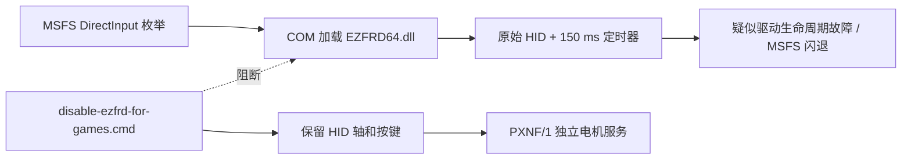
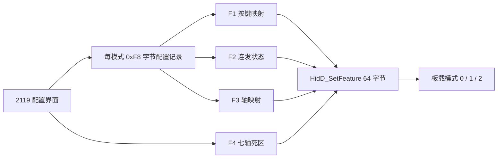
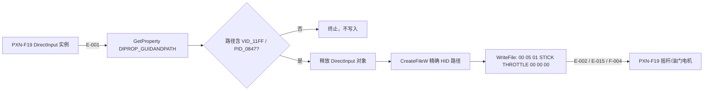
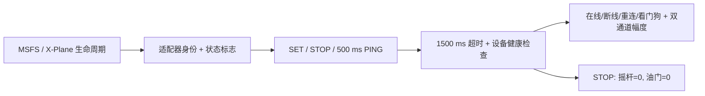
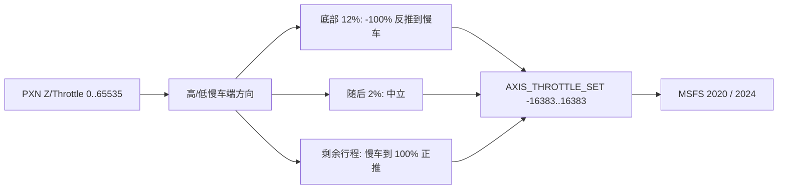
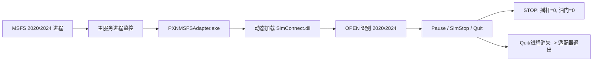

# PXN-F19 / 2119 Pro 震动输出逆向分析报告

> 分析日期：2026-08-03  
> 分析方式：授权离线静态逆向、用户真机日志验证、Windows amd64 交叉构建  
> 工具链：radare2、Go、PE 文件检查、SHA-256

## 1. 执行摘要

PXN-F19（VID `11FF`、PID `0847`）已经能够通过 EZFRD 创建并启动
DirectInput `ConstantForce` 效果，但用户真机仍无物理震动。逆向确认
EZFRD 使用约 150 ms 的多媒体定时器计算效果并写出电机报告；当前故障
位于效果已接受之后、物理输出之前。

本次新增并验证了 `--output hidpath` 后端：它不再猜测 `MI_00`，而是
通过 DirectInput `DIPROP_GUIDANDPATH` 获取当前 PXN-F19 实例对应的精确
HID 路径，校验 VID/PID，释放 DirectInput 后写入厂商 DLL 中恢复出的电机
报告。用户已确认真机产生物理震动；修订版进一步延长测试脉冲并加入可调
模拟器增益。真机验证成功后，`hidpath` 已设为默认输出后端。后续架构又将
震动内容从核心程序拆出：默认模式现在是 `PXNF/1` 电机服务，真实感由
MSFS/X-Plane 的适配器或飞机内容管理。

针对“PXN-F19 已插入时启动 MSFS 2020 会闪退”的新问题，静态分析确认
`EZFRD64.dll` 是会被加载到游戏进程内的 DirectInput COM 效果驱动，并在
设备初始化时打开原始 HID、建立 150 ms 多媒体定时器。现已提供可逆的
`disable-ezfrd-for-games.cmd` 隔离脚本，让 MSFS 不再加载旧 DLL；桥接器则
改为通过普通 DirectInput 枚举取得精确 HID 路径。该机制和构建已验证，
用户也已确认注销 EZFRD 后带着 PXN-F19 启动 MSFS 2020 不再
闪退。因未获取原闪退的崩溃转储，精确异常指令仍未知。

本次进一步解密了原厂 `uires.zip`，并恢复出 2119 Pro 的板载
配置协议。确认设备支持三组板载模式、按键连发、键盘/鼠标/手柄
重映射、10 个轴向映射槽、7 轴独立死区和配置文件导入导出。这些
并非单纯 UI 选项，而是通过 F1/F2/F3/F4 四类 64 字节 HID
Feature Report 写入设备。

本次状态链扩展保持 `PXNF/1` 16 字节包容：服务现在能识别
MSFS 2020、MSFS 2024、X-Plane 12 和通用 MSFS 适配器，显示设备
在线/断线/重连、模拟器运行状态、看门狗停止以及校准后的
摇杆和油门电机幅度。MSFS 暂停、`SimStop`、退出，以及 X-Plane
暂停、插件停用或卸载，都会立即将两路电机归零；适配器超时
和设备断开也使用同一安全路径。

MSFS 适配器现已交付为可直接运行的 Windows amd64
`PXNMSFSAdapter.exe`。它动态加载微软 `SimConnect.dll`，编译时不再
依赖 Visual Studio、SDK 头文件或静态 `SimConnect.lib`。主服务会监测
`FlightSimulator.exe` 和 `FlightSimulator2024.exe`，自动启动同目录适配器；
适配器通过 OPEN 消息判断 2020/2024，并在 Quit 或模拟器进程消失时退出。

真机调参又确认：`--msfs-telemetry-gain 2` 持续震动后会导致设备断开，
降到 `1.5` 后运行稳定。为防止任意适配器或通道校准再次把两路电机推到
高负载，最终 HID 写入前现已加入统一安全包络：单路默认上限 220、双路
合计预算 330、每次刷新最大缓升 24。所有降幅和 STOP 仍立即执行，因此
Pause、SimStop、Quit、看门狗和适配器断线不会延迟停机。新包已通过单测、
vet 和 Windows 交叉构建，安全默认值仍需长时间真机飞行验收。

油门反推现已作为默认关闭的高级模式实现。原厂 UI 和 F3 协议只确认
`Z/Throttle` 物理轴、轴映射与死区，没有负行程固件开关；因此适配器在
用户启用后独占读取 DirectInput Z 轴，将底部 12% 映射为全反推到慢车，
随后 2% 保持中立，剩余行程重映射为慢车到全正推，并通过 SimConnect
`AXIS_THROTTLE_SET` 输出 `-16383..16383`。启用前必须在 MSFS 控制设置中
解除原 PXN-F19 油门轴绑定，以免两路输入竞争。

## 2. 范围与目标

授权、分析范围、离线网络策略和排除项见
[scope.md](work/pxn-f19-ffb/scope.md)。本次目标是恢复 PXN-F19 的震动
输出链，并为 MSFS 2020、MSFS 2024 和 X-Plane 12 提供统一桥接器。

| 资产 | 类型 | 大小 | SHA-256 |
|---|---|---:|---|
| `PXNJoystick.exe` | PE32 x86 厂商控制程序 | 5,565,440 | `d759147b653e9fe917d811b664acaaff9286e9d78148e9bf8b60eb048817642a` |
| `EZFRD.dll` | PE32 DirectInput 效果驱动 | 1,612,288 | `e34207f31f37e19d18edafec134742c45cb7134f5f9d89ecdeb3046fba68d503` |
| `EZFRD64.dll` | PE32+ DirectInput 效果驱动 | 2,210,304 | `a36571f371c6c0b1965aa1f0562b3356ddd44bd92566cbd188d17b68af0fa7e8` |
| `uires.zip` | 加密 UI/布局资源 | n/a | `f4e86c90266bc07041708adc50635266cdb6f13b00ffd0505d0ae470b96ff8f3` |
| `PXN2119FFBBridge.exe` | PE32+ Windows x86-64 | 3,055,616 | `32a31f5350122b83f85e29acedb6133f5199568e59fed314df37fff6b6f3588b` |
| `PXNMSFSAdapter.exe` | PE32+ Windows x86-64 | 2,463,744 | `1a1e223ab649aa32c86776cf4208e6f8d0d6f0950c6c61167a1d7d3b2f46ab4f` |
| `PXN2119-FFB-Bridge.zip` | 交付包 | 2,427,897 | `04282aa44a34f8e83d6069bec4f09b473ce07e2df56716494aa5a8099bf8a011` |

## 3. 快速验证

若 PXN-F19 已插入时启动 MSFS 2020 会闪退，先关闭
`PXNJoystick.exe`，将新交付包解压到 PXNJoystick 安装目录，然后在
管理员命令提示符执行：

```cmd
disable-ezfrd-for-games.cmd
PXN2119FFBBridge.exe --mode service
```

保持服务运行，在 PXN-F19 仍已连接的情况下启动 MSFS 2020。
验证三项：游戏能进入主菜单、摇杆轴/按键仍正常、服务输出：

```text
PXN-F19 connected through DirectInput-selected native HID
PXN motor service listening on udp://127.0.0.1:21190 (PXNF/1)
Motor safety: stick-max=220 throttle-max=220 budget=330 slew=24/update
Status: device=online adapter=none simulator=waiting stick=0 throttle=0
```

适配器连入后，`adapter` 将显示 `MSFS 2020`、`MSFS 2024`、
`X-Plane 12` 或 `MSFS`，`simulator` 显示 `active`、`paused`、
`stopped`、`exiting` 或 `watchdog-stopped`。`stick` 和 `throttle` 是经通道
校准后的实际输出幅度。如果不需要周期状态行，可使用
`--status-interval 0`。

启动模拟器前可先验证适配器生命周期状态机：

```cmd
PXNMSFSAdapter.exe --self-test
```

正常情况下无需手动运行它：主服务检测到 MSFS 进程后会自动启动，
并在模拟器 Quit 后回收。可用 `--msfs-adapter off` 禁用自动启动，
或传入自定义 EXE 路径。

首次飞行使用已验证稳定的遥测增益：

```cmd
PXN2119FFBBridge.exe --mode service --msfs-telemetry-gain 1.5
```

若请求超过安全包络，程序会输出限频的 `Motor safety limit` 诊断；状态行
中的 `stick/throttle` 始终是实际写入电机的值，而不是限流前请求值。

启用底部 12% 反推区前，先在 MSFS 控制设置中删除 PXN-F19 的所有油门轴
绑定，然后运行：

```cmd
PXN2119FFBBridge.exe --mode service --msfs-telemetry-gain 1.5 --msfs-reverse-zone 0.12
```

适配器每秒显示一次 `raw`、物理 `position`、输出值和
`reverse/idle/forward`。如果推杆方向相反，增加
`--msfs-throttle-idle-end low`；中立区宽度可用
`--msfs-reverse-neutral 0.03` 调整。

若服务无法找到 PXN-F19，立即执行 `register-ezfrd.cmd` 恢复原版
效果驱动，并保留完整输出。MSFS 2024 可使用同样流程；
X-Plane 12 需单独验证启动行为。

对原版 EZFRD 的注册修改是可逆的，恢复命令为：

```cmd
register-ezfrd.cmd
```

关闭 `PXNJoystick.exe`，将新交付包解压到 PXNJoystick 安装目录，然后在
命令提示符运行：

```cmd
PXN2119FFBBridge.exe --mode service
```

在第二个 PowerShell 窗口调用公开接口：

```powershell
.\send-vibration.ps1 -Amplitude 255 -Seconds 3
```

独立硬件测试仍可运行：

```cmd
PXN2119FFBBridge.exe --mode test --output hidpath
```

预期输出：

```text
PXN-F19 connected through DirectInput-selected native HID
```

程序随后每 3 秒输出一次持续 1.5 秒的满幅测试。若需要更长的马达起转时间：

```cmd
PXN2119FFBBridge.exe --mode test --output hidpath --test-on 5s --test-cycle 6s
```

旧版遥测混合模式仍可兼容运行，但不属于新的模拟器管理架构：

```cmd
PXN2119FFBBridge.exe --mode msfs --output hidpath --gain 3
PXN2119FFBBridge.exe --mode xplane --output hidpath --gain 3
```

MSFS 2020 和 MSFS 2024 使用相同的 SimConnect 数据接口；X-Plane 12
默认通过本机 UDP 49000 的 RREF 接口提供遥测。

使用 Ctrl+C 或关闭控制台窗口结束程序。修订版会先打印
`Stopping PXN-F19 vibration...`，同步发送零幅报告，再允许进程退出。任务
管理器的“结束任务”属于强制终止，任何用户态程序都无法保证执行清理。

## 4. Evidence

| E-id | source_ref | repro_command | content_hash |
|---|---|---|---|
| E-001 | [设备路径选择](work/pxn-f19-ffb/evidence/E-001-device-path-selection.md) | 对 `EZFRD64.dll:fcn.180001600` 做静态反汇编 | `a36571f3…0fa7e8` |
| E-002 | [电机输出报告](work/pxn-f19-ffb/evidence/E-002-motor-output.md) | 对 `EZFRD64.dll:fcn.180002a60` 做静态反汇编 | `a36571f3…0fa7e8` |
| E-003 | [效果参数更新](work/pxn-f19-ffb/evidence/E-003-directinput-effect-update.md) | 检查 `DownloadEffect` 位掩码和效果 GUID | `a36571f3…0fa7e8` |
| E-004 | [COM 注册](work/pxn-f19-ffb/evidence/E-004-com-registration.md) | 运行 `register-ezfrd.cmd` 并检查双注册表视图 | n/a |
| E-005 | [效果采样](work/pxn-f19-ffb/evidence/E-005-effect-sampling.md) | 检查 `StartEffect`、定时回调和效果求值器 | `a36571f3…0fa7e8` |
| E-006 | [精确 HID 旁路](work/pxn-f19-ffb/evidence/E-006-directinput-selected-hid-bypass.md) | `PXN2119FFBBridge.exe --mode test --output hidpath` | `f3a044ce…b3d454` |
| E-007 | [真机震动验证](work/pxn-f19-ffb/evidence/E-007-hardware-vibration-validation.md) | `PXN2119FFBBridge.exe --mode test --output hidpath` | n/a |
| E-008 | [退出时停止电机](work/pxn-f19-ffb/evidence/E-008-motor-stop-on-process-exit.md) | 运行旧版后终止，再检查电机是否保持最后幅度 | n/a |
| E-009 | [模拟器管理的服务接口](work/pxn-f19-ffb/evidence/E-009-simulator-owned-service-interface.md) | 启动 service 后运行 `send-vibration.ps1` | `7559aaf9…eb7246` |
| E-010 | [MSFS 与 EZFRD 进程内隔离](work/pxn-f19-ffb/evidence/E-010-msfs-ezfrd-inprocess-crash-isolation.md) | 检查 COM 导出、HID 初始化和 `timeSetEvent` 回调 | `a36571f3…0fa7e8` |
| E-011 | [加密 UI 与板载功能](work/pxn-f19-ffb/evidence/E-011-encrypted-ui-and-onboard-features.md) | 解密 `uires.zip` 并检查 2119 XML 布局 | `d759147b…7642a`, `f4e86c90…ff8f3` |
| E-012 | [板载 Feature Report 协议](work/pxn-f19-ffb/evidence/E-012-onboard-feature-report-protocol.md) | 反汇编 F1/F2/F3/F4 报告构造及上传循环 | `d759147b…7642a` |
| E-013 | [EZFRD 效果实现矩阵](work/pxn-f19-ffb/evidence/E-013-ezfrd-effect-matrix.md) | 检查效果求值器及 11 项跳转表 | `a36571f3…0fa7e8` |
| E-014 | [MSFS 隔离真机验证](work/pxn-f19-ffb/evidence/E-014-msfs-isolation-hardware-validation.md) | 注销 EZFRD 后带设备启动 MSFS 2020 | n/a |
| E-015 | [双电机、校准与重连实现](work/pxn-f19-ffb/evidence/E-015-independent-motor-calibration-and-reconnect.md) | Go 测试、Windows 交叉编译及 ZIP 哈希校验 | `ae933124…44408`, `aa45878d…ea7e8` |
| E-016 | [模拟器身份与运行状态](work/pxn-f19-ffb/evidence/E-016-simulator-identity-and-runtime-status.md) | Go 测试、vet、Windows 交叉编译及 ZIP 哈希校验 | `ff5dbac6…d725d`, `8aa52d37…9426a17` |
| E-017 | [已编译 MSFS 适配器与自动托管](work/pxn-f19-ffb/evidence/E-017-compiled-msfs-adapter-and-supervisor.md) | 适配器自检、Go 测试、Windows 双 EXE 交叉编译及 ZIP 哈希校验 | `62a8c547…ccd6b4`, `08c60d22…aa9fe`, `4eafc27b…e377f` |
| E-018 | [MSFS 2020 KittyHawk 真实运行事件](work/pxn-f19-ffb/evidence/E-018-msfs2020-kittyhawk-runtime-events.md) | `PXNMSFSAdapter.exe --service 127.0.0.1:21190` | `d39aa942…e9b6a`, `8a2edb3c…77d74c` |
| E-019 | [MSFS SimVar 双通道震动混合](work/pxn-f19-ffb/evidence/E-019-msfs-simvar-vibration-mixer.md) | Go 测试、Windows 交叉编译和 ZIP 校验 | `aad5e718…1666aeb`, `2872a895…b91a84`, `4a705de4…2b9637` |
| E-020 | [Windows UDP 轮询与 SimStart 恢复修复](work/pxn-f19-ffb/evidence/E-020-windows-udp-poll-and-simstart-resume-fix.md) | 真实日志、Go 测试、Windows 交叉编译和 ZIP 校验 | `1e65ecb6…f8f246`, `90288290…1424d7`, `19543ecc…9f90f` |
| E-021 | [最终电机安全包络](work/pxn-f19-ffb/evidence/E-021-final-motor-safety-envelope.md) | 真机增益阈值、Go 测试、vet、Windows 交叉编译和 ZIP 校验 | `b1801c9b…37b86`, `90288290…1424d7`, `3d947716…b2c6` |
| E-022 | [MSFS 底部反推区油门](work/pxn-f19-ffb/evidence/E-022-msfs-reverse-zone-throttle.md) | 原厂 Z 轴证据、曲线单测、vet、Windows 交叉编译和 ZIP 校验 | `32a31f53…f3588b`, `1a1e223a…f46ab4f`, `04282aa4…8a011` |

## 5. Findings

### F-001：此前原生 HID 回退选择了错误端点

- severity: `n/a_re`
- category: `reverse_algo`
- status: `validated`
- evidence_ids: `[E-001, E-002]`
- confidence: `high`
- location: `EZFRD64.dll:fcn.180001600`
- impact: 猜测 `MI_00` 会触发类似警报的声音，不能证明该集合是电机端点。
- remediation: 必须根据 DirectInput 实例身份选择 HID 路径，禁止盲猜集合。

### F-002：DirectInput 效果创建错误来自 COM 注册

- severity: `n/a_re`
- category: `misconfig`
- status: `validated`
- evidence_ids: `[E-004]`
- confidence: `high`
- location: CLSID `{2D815FAD-11FF-0847-9310-F8608879882B}`
- impact: 未正确注册时，`CreateEffect` 返回 `0x80040154`。
- remediation: 分别注册并验证 32/64 位 EZFRD DLL 的精确路径。

### F-003：EZFRD 接受 ConstantForce，但定时输出链未产生真机震动

- severity: `n/a_re`
- category: `design`
- status: `validated`
- evidence_ids: `[E-003, E-005]`
- confidence: `high`
- location: `EZFRD64.dll:0x180002210, 0x180002840, 0x180003210`
- impact: 用户日志显示效果创建、启动成功，仍无物理输出。

### F-004：厂商电机报告和幅度语义已恢复

- severity: `n/a_re`
- category: `reverse_algo`
- status: `validated`
- evidence_ids: `[E-002, E-006, E-015]`
- confidence: `high`
- location: `EZFRD64.dll:fcn.180002a60`, `PXNJoystick.exe:0x004b8a40`
- impact: 原始报告格式为 `00 05 01 STICK THROTTLE 00 00 00`；这两个字段在旧 PXNF/1 源码中名为 `left/right`。EZFRD 效果求值路径会将一个最大幅度复制到两路，但原厂电机预览路径能够独立写入摇杆和油门电机。
- remediation: 原生 HID 服务应保留摇杆/油门通道，并将各通道分别映射到完整字节范围 `0..255`。

### F-005：精确路径原生输出已通过真机验证

- severity: `n/a_re`
- category: `bypass`
- status: `validated`
- evidence_ids: `[E-001, E-002, E-006, E-007]`
- confidence: `high`
- location: `ffb-bridge/main_windows.go:newHIDMotor`
- impact: 已绕过 EZFRD 定时器并在 PXN-F19 真机产生震动，同时保留厂商的实例身份选择约束。
- remediation: 使用更长测试脉冲和 `--gain` 调整主观强度，输出仍限制在 `0..255`。

### F-006：进程退出前必须显式发送零幅报告

- severity: `low`
- category: `design`
- status: `validated`
- evidence_ids: `[E-008]`
- confidence: `high`
- location: `ffb-bridge/main_windows.go:main, installConsoleStopHandler`
- impact: 旧版被 Windows 默认终止时跳过 defer，PXN-F19 保持最后一次电机幅度。
- remediation: 捕获 Go 中断及 Windows 控制台控制事件，等待零幅报告写完再退出。

### F-007：真实感效果应由模拟器适配器管理

- severity: `n/a_re`
- category: `design`
- status: `validated`
- evidence_ids: `[E-009]`
- confidence: `high`
- location: `ffb-bridge/service_windows.go`, `ffb-bridge/adapters/`
- impact: 核心服务不再硬编码失速、着陆、跑道等效果，只执行模拟器给出的最终摇杆/油门幅度。
- remediation: MSFS 内容通过 SimConnect ClientData、X-Plane 内容通过可写 DataRef 调用 PXNF/1 服务。

### F-008：隔离 EZFRD 后 MSFS 启动闪退消失

- severity: `medium`
- category: `design`
- status: `validated`
- evidence_ids: `[E-010, E-014]`
- confidence: `high`
- location: `EZFRD64.dll:DllRegisterServer, 0x180001cc0, 0x1800018a0, 0x1800018b0`
- impact: DirectInput 枚举 FFB 设备时可将旧 DLL 直接加载到 `FlightSimulator.exe`；用户真机确认注销该效果类后，带着 PXN-F19 启动 MSFS 2020 不再闪退。
- remediation: 保持 EZFRD COM 效果类与游戏进程隔离，用独立 PXNF/1 服务承担电机输出；若需定位原版 DLL 的精确故障点，应采集崩溃转储。

### F-009：2119 Pro 存在未充分公开的板载配置能力

- severity: `n/a_re`
- category: `reverse_algo`
- status: `validated`
- evidence_ids: `[E-011, E-012]`
- confidence: `high`
- location: `PXNJoystick.exe`, `uires.zip/xml/*2119*.xml`
- impact: 设备支持三组板载模式、24 个有效重映射位置、逐键连发、键盘/鼠标/手柄重映射、10 个轴映射槽、7 轴独立死区及配置导入导出。
- remediation: 将这些能力作为板载配置服务使用；修改前保存配置，不要向保留字段发送未经确认的值。

### F-010：F1/F2/F3/F4 是板载配置协议

- severity: `n/a_re`
- category: `protocol`
- status: `validated`
- evidence_ids: `[E-012]`
- confidence: `high`
- location: `PXNJoystick.exe:0x004b6bd0-0x004b6c90`
- impact: F1 上传按键映射，F2 上传逐键连发值，F3 上传轴映射，F4 上传 0..100 的轴参数；每个报告长度均为 64 字节。
- remediation: 只使用已恢复并有 UI 验证的槽位和参数 ID；F4 的 `22/24/27` 等保留 ID 不应直接在真机试写。

### F-011：EZFRD 只完整覆盖非条件型效果族

- severity: `n/a_re`
- category: `reverse_algo`
- status: `validated`
- evidence_ids: `[E-005, E-013]`
- confidence: `high`
- location: `EZFRD64.dll:0x180003210`
- impact: ConstantForce、RampForce、Square、Sine、Triangle、SawtoothUp、SawtoothDown 有执行路径；Spring、Damper、Inertia、Friction 为零值桩。部分周期效果共用简化求值器，波形保真度有限。
- remediation: 模拟器适配器应主要输出摇杆和油门电机幅度，不依赖原版驱动实现条件力反馈。

### F-012：独立摇杆/油门电机、校准和安全重连已实现

- severity: `n/a_re`
- category: `design`
- status: `candidate`
- evidence_ids: `[E-015]`
- confidence: `high`
- location: `ffb-bridge/main_windows.go`, `calibration.go`, `motor_core.go`
- impact: PXNF/1 的摇杆/油门字节不再被合并；服务支持每通道增益和最低起转幅度、单电机测试、断线重连、重连归零以及旧命令不重放。`left/right` 仍作为兼容名称。
- remediation: 在 Windows 真机分别运行摇杆、油门和双通道测试后，将状态提升为 validated。

### F-013：模拟器与设备生命周期状态已接入服务

- severity: `n/a_re`
- category: `design`
- status: `candidate`
- evidence_ids: `[E-016]`
- confidence: `high`
- location: `ffb-bridge/service_core.go`, `service_windows.go`, `adapters/msfs/PXNMSFSAdapter.cpp`, `adapters/xplane/PXNXPlaneAdapter.cpp`
- impact: 不改变 PXNF/1 16 字节布局即可显示适配器身份、模拟器状态、校准后摇杆/油门幅度、设备断线/重连及看门狗停止；暂停、停止、退出、适配器超时或设备丢失均清空两路电机。
- remediation: 在 MSFS 2020/2024 对已编译 EXE 完成 SimConnect 运行时验收；使用 XPLM SDK 编译 X-Plane 插件，并在三个模拟器验收暂停、恢复、退出、断线重连和看门狗行为。

### F-014：MSFS 适配器已编译并由主服务自动托管

- severity: `n/a_re`
- category: `design`
- status: `candidate`
- evidence_ids: `[E-017]`
- confidence: `high`
- location: `ffb-bridge/cmd/pxn-msfs-adapter`, `msfs_supervisor_windows.go`, `internal/winproc`
- impact: 发布包已包含可运行的 Windows amd64 `PXNMSFSAdapter.exe`；服务检测 MSFS 进程后启动适配器，OPEN 判断 2020/2024，Pause/SimStop/Quit 清空双电机，Quit 和进程消失都会结束适配器。
- remediation: 在已安装 `SimConnect.dll` 的 Windows 环境分别运行 MSFS 2020/2024，完成自动启动、版本识别、Pause、SimStop、Quit 和崩溃回退验收。

### F-018：高增益持续双电机输出需要最终硬件安全包络

- severity: `medium`
- category: `design`
- status: `candidate`
- evidence_ids: `[E-021]`
- confidence: `high`
- location: `ffb-bridge/motor_safety.go`, `main_windows.go:runOutputLoop`
- impact: 用户真机确认遥测增益 2.0 震动一段时间后设备断开，而 1.5 稳定。确切原因尚未用 USB 电流仪测量，但现象符合供电压降、控制器过流或固件电机保护。校准增益和任意适配器请求都可能产生 255/255，因此只在 MSFS 混合器内降增益不够可靠。
- remediation: 在校准之后、HID 写入之前统一执行单路上限、双路比例预算和上升沿限制；STOP 及所有降幅必须立即执行。新默认值需通过长时间 MSFS 真机飞行验收。

### F-019：反推需要由适配器独占并输出有符号油门轴

- severity: `n/a_re`
- category: `design`
- status: `candidate`
- evidence_ids: `[E-012, E-022]`
- confidence: `high`
- location: `ffb-bridge/internal/throttlezone`, `cmd/pxn-msfs-adapter/throttle_input_windows.go`, `reverse_throttle_windows.go`
- impact: 原厂板载协议只提供 Z/Throttle 映射和死区，无法把物理底端扩成负推力。高级模式现将底部 12% 映射为 `-16383..0`，2% 中立区映射为 0，其余行程映射为 `0..16383`，并允许选择原始高端或低端作为物理慢车端。
- remediation: 启用时必须解除 MSFS 中的原 PXN 油门轴绑定；先用原生飞机验收方向、中立区和反推，再为忽略通用 SimConnect 事件的自定义 WASM 飞机增加专用配置。

## 6. Path

### P-003：模拟器内容到 PXN 电机服务

- path_type: `callflow`
- start: MSFS/X-Plane 飞机或效果内容
- goal: 执行由模拟器决定的最终震动命令
- residual_risks: 两个适配器需要对应官方 SDK 编译并在模拟器内联调


### P-004：将旧 EZFRD 从 MSFS 进程隔离

- path_type: `callflow`
- start: PXN-F19 在 MSFS 启动前已连接
- goal: 保留输入和独立震动服务，防止游戏加载旧 EZFRD DLL
- residual_risks: 输入枚举和 HID 精确路径已经通过 Windows 真机验证；原闪退的确切异常地址因缺少崩溃转储仍未知



步骤：

1. DirectInput 发现已注册的 FFB 效果类并进程内加载 EZFRD — evidence: E-010 — finding: F-008。
2. EZFRD 打开原始 HID 并创建 150 ms 周期回调 — evidence: E-010 — finding: F-008。
3. 隔离脚本注销 32/64 位 COM 类，不卸载 HID 输入设备 — evidence: E-010 — finding: F-008。
4. 服务通过普通 DirectInput 实例获得 `DIPROP_GUIDANDPATH` 并输出震动 — evidence: E-006, E-010 — finding: F-005。
5. 用户带着 PXN-F19 启动 MSFS 2020，确认隔离后不再闪退 — evidence: E-014 — finding: F-008。

### P-005：UI 设置写入板载配置

- path_type: `callflow`
- start: 解密后的 2119 配置界面和用户设置
- goal: 将三组模式的映射、连发、轴映射和死区保存到设备
- residual_risks: F3 类型 2/3 的精确差异、F4 保留 ID 和鼠标按钮 6–8 的可选性尚未确认



### P-002：DirectInput 精确选路到原生电机输出

- path_type: `callflow`
- start: PXN-F19 DirectInput 设备实例
- goal: 向正确的 PXN-F19 HID 集合写入电机报告
- residual_risks: 马达体积和安装结构限制最大体感强度；需在模拟器场景继续调参



步骤：

1. DirectInput 枚举并锁定 PXN-F19 实例 — evidence: E-001 — finding: F-001。
2. 读取 `DIPROP_GUIDANDPATH` 并校验 VID/PID — evidence: E-006 — finding: F-005。
3. 释放 DirectInput，打开精确路径 — evidence: E-006 — finding: F-005。
4. 写入独立摇杆/油门幅度字节；EZFRD 诊断路径仍会合并幅度 — evidence: E-002, E-015 — finding: F-004。

### P-006：模拟器双通道经过校准与重连控制器

- path_type: `callflow`
- start: PXNF/1 `SET(stick/left, throttle/right, duration, sequence)`
- goal: 独立、安全地驱动 PXN-F19 摇杆和油门电机
- residual_risks: 自动化和交叉构建已通过，独立摇杆/油门物理输出仍需 Windows 真机确认


安全层默认 `stick-max=220`、`throttle-max=220`、`motor-budget=330`、
`motor-slew=24`。双路超预算时按比例缩放，保持模拟器请求的相对强弱；
降低幅度和 STOP 不经过缓降 — evidence: E-021 — finding: F-018。

### P-007：模拟器生命周期到状态显示与安全停机

- path_type: `callflow`
- start: MSFS `OPEN/Pause/SimStart/SimStop/Quit` 或 X-Plane `paused/disable/unload`
- goal: 持续显示适配器、设备和双电机状态，并在暂停/退出/超时/断线时立即归零
- residual_risks: Go 服务端已验证；适配器需要官方 SDK 编译和三个模拟器内的真实运行验收



步骤：

1. MSFS 从 `SIMCONNECT_RECV_OPEN` 的应用名/版本识别 2020/2024，X-Plane 标识为 12 并监控 `sim/time/paused` — evidence: E-016 — finding: F-013。
2. 适配器在空闲或暂停时仍每 500 ms 发送心跳，暂停/停止/退出时立即发送 STOP — evidence: E-016 — finding: F-013。
3. 服务跟踪适配器和 1500 ms 超时，显示校准后幅度、设备状态和看门狗状态 — evidence: E-016 — finding: F-013。
4. 断线、重连、看门狗或模拟器停止路径均不重放旧命令，两路电机先归零 — evidence: E-015, E-016 — finding: F-012, F-013。

### P-011：PXN 物理油门到 MSFS 有符号反推轴

- path_type: `callflow`
- start: PXN-F19 DirectInput `Z/Throttle` 物理轴
- goal: 用同一物理行程控制 MSFS 正推、慢车和反推
- residual_risks: 自动化和 Windows 交叉构建已通过；必须解除原游戏轴绑定，并在真实飞机上验收；自定义 WASM 飞机可能忽略通用事件



Pause、SimStop、Quit、DirectInput 断线和适配器退出均立即发送油门轴 0 —
evidence: E-022 — finding: F-019。

### P-008：MSFS 进程到受托管 SimConnect 适配器

- path_type: `callflow`
- start: `FlightSimulator.exe` 或 `FlightSimulator2024.exe` 出现
- goal: 自动运行唯一适配器，并在模拟器结束时安全归零和退出
- residual_risks: 离线自检、单测和 Windows 交叉编译已通过；真实 SimConnect 消息分发仍需 MSFS 2020/2024 验收



## 7. 构建与检查

交叉构建执行：

```bash
env GOROOT=/tmp/go-toolchain \
PATH=/tmp/go-toolchain/bin:/usr/bin:/bin \
GOCACHE=/tmp/pxn-go-cache \
GOMODCACHE=/tmp/pxn-go-modcache \
GOOS=windows GOARCH=amd64 CGO_ENABLED=0 \
/tmp/go-toolchain/bin/go test -buildvcs=false ./...

env GOROOT=/tmp/go-toolchain \
PATH=/tmp/go-toolchain/bin:/usr/bin:/bin \
GOCACHE=/tmp/pxn-go-cache \
GOMODCACHE=/tmp/pxn-go-modcache \
GOOS=windows GOARCH=amd64 CGO_ENABLED=0 \
/tmp/go-toolchain/bin/go build -buildvcs=false -trimpath \
-ldflags='-s -w' -o PXN2119FFBBridge.exe .

env GOOS=windows GOARCH=amd64 CGO_ENABLED=0 \
/tmp/go-toolchain/bin/go build -buildvcs=false -trimpath \
-ldflags='-s -w' -o PXNMSFSAdapter.exe ./cmd/pxn-msfs-adapter
```

结果为 `PE32+ executable (console) x86-64, for MS Windows`，Go 测试以
61.0% statement coverage 通过，`go vet` 和 Windows amd64 测试二进制
交叉编译也通过。

## 8. Timeline 摘要

完整记录见 [timeline.md](work/pxn-f19-ffb/timeline.md)。关键节点包括：

1. 恢复 EZFRD 的 DirectInput 实例到 HID 路径匹配逻辑。
2. 恢复电机报告、效果下载掩码和 COM 注册要求。
3. 修复效果 GUID、`DIEP_TYPESPECIFICPARAMS` 和 ConstantForce 测试。
4. 根据用户“效果成功但无震动”的真机结果，实现 `hidpath` 后端。
5. 将 MSFS 启动闪退与 EZFRD 进程内 COM 加载机制建立证据链，加入可逆隔离脚本，并由用户真机确认闪退消失。
6. 解密原厂 UI 资源，恢复三组板载配置及 F1/F2/F3/F4 Feature Report 协议。
7. 恢复 EZFRD 的 11 项效果矩阵，确认 7 项有实现、4 项条件力效果为桩。
8. 将 PXNF/1 改为端到端保留摇杆/油门通道，加入校准、单电机测试和不重放旧命令的自动重连。
9. 为 MSFS 2020、MSFS 2024 和 X-Plane 12 加入适配器身份、运行状态、设备健康、双电机幅度和暂停/退出归零链路。
10. 交付 `PXNMSFSAdapter.exe`，加入 MSFS 进程监测、适配器自动启动/退出和 2020/2024/Pause/SimStop/Quit 离线自检。
11. 根据增益 2.0 掉线、1.5 稳定的真机证据，在最终 HID 边界加入单路峰值、双路预算和上升沿保护，并保持立即 STOP。
12. 确认原厂 Z/Throttle 轴没有负行程配置后，加入默认关闭的 12% 反推区、2% 中立区和有符号 SimConnect 油门输出。

## 9. 遗留问题

- 真机已确认 `hidpath` 能产生震动，但最大体感强度仍受硬件马达限制。
- 需要分别在 MSFS 2020、MSFS 2024 和 X-Plane 12 飞行场景验证遥测混合曲线。
- 首次飞行应保持 `--msfs-telemetry-gain 1.5`；新安全包络会进一步限制最终硬件负载。
- 新安全默认值已通过自动化和 Windows 交叉构建，但仍需一次长时间 MSFS 真机飞行确认不再断开。
- 反推高级模式必须先解除 MSFS 中的原物理油门轴绑定；当前已通过自动化和 Windows 交叉构建，尚待真机飞机验收。
- 使用自定义 WASM 油门系统的飞机可能忽略通用 `AXIS_THROTTLE_SET`，需要后续增加按机型选择的事件或数据接口。
- 任务管理器强制结束进程无法执行用户态清理；应使用 Ctrl+C 或关闭控制台窗口。
- MSFS 适配器 EXE 已生成，但必须在 Windows 上能加载微软 `SimConnect.dll`；自动启动、2020/2024 OPEN 识别、Pause/SimStop/Quit STOP 和崩溃回退尚需真实模拟器验收。
- X-Plane 适配器源码仍需 X-Plane SDK 编译并进行运行时验收。
- MSFS 2020 隔离已由用户真机验证，但由于没有原闪退的 Windows WER/崩溃转储，仍无法指出 EZFRD 内部的确切异常指令。
- X-Plane 12 尚未测试“连接 PXN-F19 后启动”的行为。
- F4 参数 ID `22`、`24`、`27` 等保留字段尚未确认；为避免破坏板载状态，未对真机进行盲测。
- 本地化资源出现鼠标按钮 6–8，但可见鼠标映射对话框只提供 1–5，因此 6–8 目前仅是候选能力。
- 未发现固件升级、灯光控制或可编程宏序列的证据。
- 双通道代码、校准和重连已完成自动化验证；仍需在 Windows 真机确认摇杆和油门电机可以被分别驱动。
